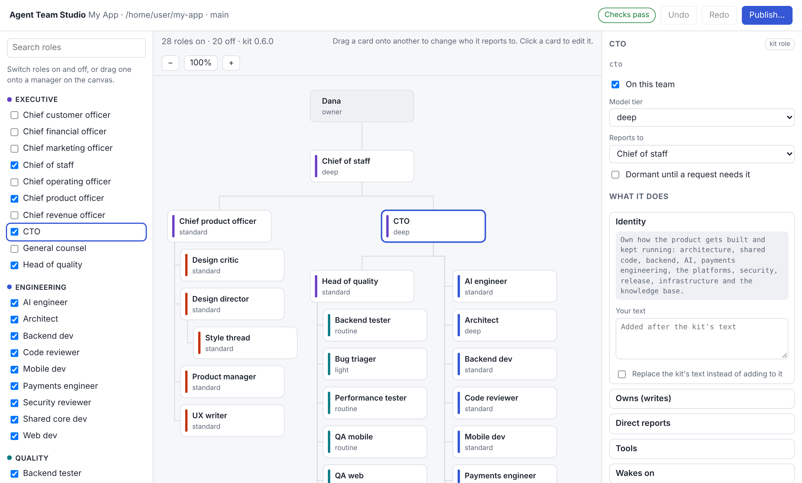
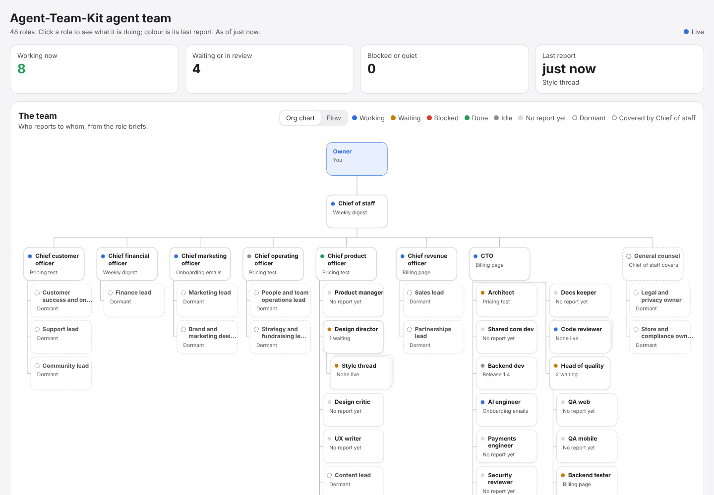

# Agent Team Kit

**Run a whole company of Claude Code agents on your repository.** One door for you, an executive per lane, and 48 role briefs (CTO, architect, devs, QA, reviewers, release manager, designers, marketing, sales, support, finance, legal and more) that hand work to each other in fixed shapes, sign off with evidence, and report to a board you can watch.

The kit grew out of a real product built by a team of Claude threads. It is the operating manual that made that team work, with the project-specific parts taken out.

```
Owner
└─ chief-of-staff                      the one door; daily digest
   ├─ cto ─ Engineering                architect, backend, web, mobile, AI, payments, security, release, infra, docs
   │  └─ head-of-quality               QA web and mobile, backend tests, automation, performance, triage
   ├─ cpo ─ Product and design         product manager, design director + style threads, critic, UX writer
   ├─ cmo, cro ─ Go-to-market          marketing, brand, sales, partnerships        (dormant until needed)
   ├─ cco ─ Customer                   onboarding, support, community               (dormant until needed)
   └─ cfo, general-counsel, coo        finance, legal, compliance, strategy, team ops (dormant until needed)
```

## Why

Give one agent a big task and it does everything at once, badly. Give ten agents the same task and they trip over each other. The kit adds the parts a real team relies on:

- **One door.** You talk to the chief of staff only. Your words travel down the tree verbatim, quoted, with an issue id, so nothing gets lost in paraphrase.
- **One writer per path.** Every folder has an owner. Everything else is a request.
- **Fixed message shapes.** HANDOFF, BUG, SIGNOFF and BLOCKED, each with required fields. A SIGNOFF without screenshots or logs is invalid.
- **Separation of duties.** The author never approves their own work: a QA role walks it, a reviewer reads it, a critic judges the visuals, the security reviewer reads anything touching auth or money.
- **Memory that survives threads.** Every role keeps a five-part memory file and resumes from it.
- **A board.** Every role reports what it is doing, so you (and the chief of staff's daily digest) see the whole team at a glance.
- **Shared hardware without melting it.** Builds, emulators and local backends run through lock slots.

## Use it in your repository

The kit is a dependency, not a template. Your repository keeps only what is specific to it, in `.agent-team/`; the briefs, protocols and scripts are generated from a pinned kit version. Improve the kit once and every team picks it up on the next sync.

Requirements: git and Node 18+, plus bash and `jq` for the merge gate and locks (Git Bash or WSL on Windows; see [docs/windows.md](docs/windows.md)). Claude Code with project threads (claude.ai) or the CLI.

```sh
cd ~/code/my-app
npx --yes github:PurpleGiragge/Agent-Team-Kit#v0.10.0 init --preset engineering --project "My App" --owner "Sam" --timezone "Pacific"
```

Then:

1. Edit `docs/team/ownership.md` so the paths match your layout.
2. Edit the gates and hardware pools in `.agent-team/config.sh`.
3. Paste `docs/team/project-instructions.md` into your Claude project's instructions (or into `CLAUDE.md`).
4. Commit `.agent-team/`, `docs/team/`, `scripts/agent-team/` and `.claude/settings.json` (the hooks that report for the roles), and add `scripts/agent-team/sync.sh check` to CI. `npx --yes github:PurpleGiragge/Agent-Team-Kit#v0.10.0 doctor` smoke-tests the whole setup.
5. Open the chief of staff: *"You are the chief of staff. Read docs/team/roles/chief-of-staff.md and docs/team/protocols.md, then tell me what you need from me."*
6. Ask for something. Watch it live with `node scripts/agent-team/dashboard.mjs` (a web dashboard at http://localhost:4747) or `scripts/agent-team/team-board.sh` in the terminal.

### What lives where

```
your-repo/
  .agent-team/                  yours: the project layer
    team.json                   kit version, preset, include/exclude, project values, hooks, agent teams
    config.sh                   merge gates, hardware pools, janitor extras
    roles/<role>.extend.md      change a kit role: extra rules, another model tier, a replaced section
    roles/<role>.md             your own roles (or a full replacement of a kit role)
    protocols.extend.md         project-wide rules
    kit.lock.json               what sync generated, for "sync.sh check"
  docs/team/
    ownership.md, lanes/        yours: who writes which path, each executive's priorities
    protocols.md, roles/, ...   generated, do not edit
  scripts/agent-team/           generated: team-status, report, team-board, dashboard, merge-gate, with-lock, janitor, roster, sync
  .claude/settings.json         yours, with the kit's reporting hooks merged in by sync
```

`scripts/agent-team/sync.sh` regenerates from `.agent-team/`. To upgrade, change `"kit"` in `team.json` to a newer tag and run it. `scripts/agent-team/sync.sh roles` shows every role and whether it comes from the kit, an extension or your repository.

[examples/native-mobile](examples/native-mobile) is a complete project layer for a product with Android and iOS apps: it adds four roles, replaces two direct-report lists, extends three roles and defines Gradle and Xcode gates, without copying anything from the kit.

### Presets

| Preset | Roles | For |
| --- | --- | --- |
| `minimal` | 11 | A small product: chief of staff, CTO, PM, architect, backend, web, reviewer, security, QA, release, docs |
| `engineering` (default) | 28 | The full product and engineering organisation |
| `company` | 48 | Everything, with business roles dormant until a request needs them |

## Three ways to run the team

**Threads (the original setup).** Each role is its own long-lived Claude Code thread in a claude.ai project, running as Remote Control or cloud sessions on your repository. The chief of staff is the project coordinator and wakes roles as the work needs them. Best for long-running products: roles work in parallel, each in its own worktree, and keep their own memory.

**Subagents (one session).** Set `"subagents": true` in `team.json` (or pass `--subagents` to `init`) and sync writes every active role to `.claude/agents/`. One Claude Code session can then delegate to `architect`, `backend-dev`, `qa-web` or `code-reviewer` on demand. Best for trying the kit or for smaller projects.

**Claude Code agent teams (a lead and its reports).** Set `"agentTeams": true` and sync installs the roles as teammate types, turns on Claude Code's experimental agent teams and writes `docs/team/agent-teams.md` with a spawn prompt for each lead. A lead such as the CTO starts a team of `backend-dev`, `code-reviewer` and `qa-web` for one job, and every teammate shows on the board. See [docs/hooks-and-agent-teams.md](docs/hooks-and-agent-teams.md).

See [docs/running-the-team.md](docs/running-the-team.md) for threads and subagents.

## What is in this repository

```
bin/agent-team.mjs              the CLI: init, sync, check, roles, dashboard, doctor
presets/                        role lists for minimal, engineering, company
team/                           the framework: protocols, project instructions, ownership seed, 48 role briefs
scripts/                        runtime scripts generated into scripts/agent-team/
tools/                          roster checker, subagent export, the Node reporter and hooks, doctor and the dashboard (server + page)
templates/                      config.sh, sync.sh, sync.mjs and the roles README for new projects
examples/native-mobile/         a full project layer for native Android and iOS apps
board/supabase/                 optional hosted board (table, views, Edge Function)
docs/                           how it works, running the team, customising, the dashboard
tests/                          tests for the CLI, scripts and tools, smoke scenarios and evals of every preset
```

## Anatomy of a role brief

```markdown
# Backend dev

**Model:** standard                 tier: deep, standard, routine or light
**Group:** engineering              board band
**Reports to:** cto                 the org tree is built from this line
**Status:** dormant until ...       (optional) opened only when a request needs it

## Identity        what this role owns and how it is judged
## Owns (writes)   its paths; everything else is a request
## Tools           skills, plugins, MCP servers
## Wakes on        what starts a task
## Hands to        who it sends work to
## Rules           two to five role-specific rules
## Every thread, every task   the shared footer: memory, protocols, board reports
```

`agent-team import` prints the whole team as one JSON document (a TeamSpec), and `agent-team compile <spec.json>` writes one back. The upcoming visual editor builds on this ([packages/team-model](packages/team-model)).

`node scripts/agent-team/roster.mjs --check` validates every brief (tiers, reporting lines, loops, direct reports) and `--tree` prints the org.

## Build the team visually: Agent Team Studio

```sh
npx --yes github:PurpleGiragge/Agent-Team-Kit#v0.10.0 studio --open   # opens http://localhost:4848/?t=<launch token>
```

Switch roles on and off from the library, drag a card onto another to change who it reports to, and set each role's model tier, status and duties in the inspector. **Flow** shows who hands work to whom. In **Systems**, add your database, hosting or any MCP server and drag it onto the roles that may use it. **Owned areas** and **Checks** are suggested from your repository's folders and build files. The kit's rules run on every change. **Publish** shows every file that would change, then commits the team and its generated files on a new branch for you to push and review.



The Studio, like the dashboard, answers only on `localhost`, `127.0.0.1`, `[::1]` and the address it is bound to. That way a web page on another domain cannot reach it by pointing a DNS name at your machine. To open it under another name, list that name in `STUDIO_ALLOWED_HOSTS` (comma-separated).

**Chat** talks to your team's chief of staff through the control plane (set `AGENT_TEAM_SERVER`, `AGENT_TEAM_SERVER_TOKEN` and `AGENT_TEAM_SERVER_TEAM`). With no run going, **Start a run…** starts one on the team as last published, once you set a daily cap. The Studio signs you in with the link it prints. To open it from a phone, start it with `--host 0.0.0.0` and open the network link it prints. That link is plain HTTP, so use it on trusted networks only.

## The board and the live dashboard

Every task starts with a report and every message is reported with the same fields:

```sh
scripts/agent-team/team-status.sh web-dev status working --task "Login page" --issue 12
scripts/agent-team/team-status.sh web-dev handoff waiting --to qa-web --task "Login page" --pr 14
```

With hooks on (the default), Claude Code reports for the roles too: working when a session starts or gets a prompt, a heartbeat while it uses tools, idle when its turn ends, and every subagent or teammate as its own role. A role that forgets to report no longer goes stale. Give each thread's checkout its role in `.agent-team/local.env` (`AGENT_TEAM_ROLE=<role>`, gitignored) so its own session is reported too, and point `AGENT_TEAM_HOME` at a shared folder when every thread runs on its own machine; [docs/hooks-and-agent-teams.md](docs/hooks-and-agent-teams.md) has the details. No bash or `jq`? `node scripts/agent-team/report.mjs` takes the same arguments.

Open the dashboard and leave it open. It draws your team from the role briefs, as an org chart and as a flow of hand-offs, and each role lights up the moment its thread reports. Click a role for its task, links, brief and history.

```sh
node scripts/agent-team/dashboard.mjs            # http://localhost:4747
npx --yes github:PurpleGiragge/Agent-Team-Kit dashboard --demo   # see it work with made-up reports first
```



No setup: the threads write to `~/.agent-team/<project>/events.jsonl` and the dashboard watches that file. Threads on other machines or in the cloud set `TEAM_REPORT_URL=http://<your machine>:4747/api/report` and report straight to it. To see the team from anywhere, put the same dashboard on your website, reading a [hosted board](board/supabase/README.md). [docs/dashboard.md](docs/dashboard.md) covers all three.

In a terminal, `scripts/agent-team/team-board.sh` shows the same thing:

```
ROLE     STATUS   AGE  TASK              WAITING ON
web-dev  waiting  0m   Login page PR 14  qa-web
cto      working  3m   Plan Q1
```

## How this compares

There are many projects for running teams of agents. Most of them overlap with one part of the kit, and some are much bigger. Pick by what you need.

| If you want | Look at | What the kit adds or leaves out |
| --- | --- | --- |
| A big library of single-purpose subagents | [wshobson/agents](https://github.com/wshobson/agents), [VoltAgent/awesome-claude-code-subagents](https://github.com/VoltAgent/awesome-claude-code-subagents) | Those have more roles. The kit's roles report to each other in one org, hand work over in fixed shapes and cannot approve their own work. |
| A planning method with persona agents (analyst, PM, architect, dev, QA) | [BMAD-METHOD](https://github.com/bmad-code-org/BMAD-METHOD) | BMAD is the closer, more mature match for the spec-to-story flow. The kit is about running the team after that: ownership, merge gates, sign-off evidence, a board. |
| Role-shaped slash commands for one developer | [gstack](https://github.com/garrytan/gstack) | gstack is one person switching hats. The kit is many long-lived threads with their own memory and lanes. |
| Swarm orchestration with routing and shared memory | [Ruflo (claude-flow)](https://github.com/ruvnet/ruflo) | Ruflo spawns and routes agents through an MCP server. The kit has no runtime of its own: it is briefs, protocols and scripts that Claude Code threads follow. |
| Claude Code's own agent teams (lead, teammates, task list) | [Claude Code docs](https://code.claude.com/docs) | The kit builds on it: `"agentTeams": true` installs the roles as teammate types with a spawn prompt for each lead. The built-in feature handles spawning and task claiming; the kit adds the org, the rules and a board across sessions and machines. |
| Agent teams in Python, any model | [CrewAI](https://github.com/crewAIInc/crewAI), [AutoGen](https://github.com/microsoft/autogen), [MetaGPT](https://github.com/FoundationAgents/MetaGPT), [ChatDev](https://github.com/OpenBMB/ChatDev) | Those are SDKs you program against. The kit is for Claude Code working on a real repository. |
| A live view of Claude Code sessions | Hook-based monitors such as Claude Code Agent Monitor or claude-team-dashboard | Those show raw tool calls. The kit's hooks report too, but its board is organised by role: what each one is doing, who it is waiting on, and its hand-offs, and it can be mounted on your own site. |

What the kit has that we have not found together elsewhere: a whole company org (48 briefs, with model tiers and reporting lines checked by `roster.mjs`), presets, a pinned-version sync into your repository with a CI drift check, one writer per path, merge gates and hardware locks, hook-based reports with a `doctor` smoke test, and a dashboard that runs locally or on a hosted site.

Limits today: a thread's own session is reported by the hooks only when its checkout names its role (`AGENT_TEAM_ROLE` in `.agent-team/local.env` or the environment); subagents and teammates are always reported. The merge gate and locks still need bash and `jq` (Git Bash or WSL on Windows); and it works with Claude Code only.

## Recommended plugins

The briefs work on their own and get better with these: [superpowers](https://github.com/obra/superpowers) (the method: brainstorm, plan, TDD, verify), [karpathy-guidelines](https://github.com/multica-ai/andrej-karpathy-skills) (code style), [i-have-adhd](https://github.com/ayghri/i-have-adhd) (messages to the owner lead with the next action), and [Octopus](https://github.com/nyldn/claude-octopus) (`/octo:council` second opinions on hard-to-undo decisions).

## Docs

- [How it works](docs/how-it-works.md): the org, the lanes, how a request becomes a merged PR
- [Running the team](docs/running-the-team.md): threads or subagents, worktrees, meetings
- [Customising](docs/customizing.md): extend or add roles, gates and pools, upgrade the kit
- [The dashboard](docs/dashboard.md): run it locally, report from other machines, put it on your website
- [Hooks and agent teams](docs/hooks-and-agent-teams.md): automatic reports, Claude Code agent teams, `doctor`
- [Windows](docs/windows.md): what runs on Node alone, and what needs Git Bash or WSL
- [Product plan](docs/product/): the visual team builder (PRD, architecture, deployment, delivery plan)

## Where this is going

We are turning the kit into **Agent Team Studio**: you lay out your team on a canvas, connect your repositories, backends, databases and frontends, publish to your repository, then talk to your chief of staff and let the team run. The plan is in [docs/product/](docs/product/). This repository is built by its own kit-defined team ([how](docs/product/team.md)).

## Contributing

Issues and pull requests are welcome. See [CONTRIBUTING.md](CONTRIBUTING.md).

## License

[MIT](LICENSE)
